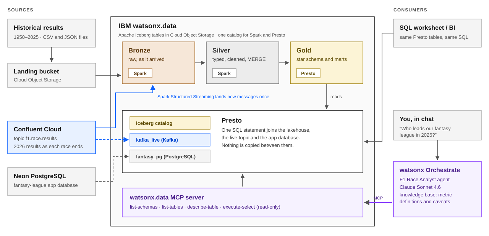

# F1 lakehouse on IBM watsonx.data, Confluent and watsonx Orchestrate

Companion code for the IBM Developer tutorial *Build a real-time medallion lakehouse with an AI
analyst using IBM watsonx.data, Confluent and watsonx Orchestrate*.

75 years of Formula 1 results land in a medallion lakehouse on IBM watsonx.data. The 2026 season
streams in live from Confluent Cloud. A fantasy-league app database stays in PostgreSQL. Presto
queries all three in one SQL statement, and an IBM watsonx Orchestrate agent answers questions in
plain English through the watsonx.data MCP server.



The full step-by-step tutorial is in [`tutorial/README.md`](tutorial/README.md).

## What each piece does

| Layer | Engine | Code |
|---|---|---|
| Landing zone | Cloud Object Storage | `python -m lakehouse upload` |
| Bronze: raw data, as it arrived | Spark | `lakehouse/spark/bronze_ingest.py` |
| Bronze: live Kafka messages | Spark Structured Streaming | `lakehouse/spark/stream_ingest.py` |
| Silver: typed, cleaned, de-duplicated, quarantined | Spark `MERGE INTO` | `lakehouse/spark/silver_transform.py` |
| Gold: star schema and season marts | Presto SQL | `lakehouse/sql/gold/*.sql` |
| Live and federated queries | Presto (Iceberg + Kafka + PostgreSQL) | `lakehouse/sql/live`, `lakehouse/sql/federation` |
| Natural-language analyst | watsonx Orchestrate + watsonx.data MCP server | `agent/` |

## Quick start

You need IBM watsonx.data (the Lite plan works), IBM watsonx Orchestrate, a Confluent Cloud
cluster, a Neon PostgreSQL database and Python 3.12. The tutorial walks through each step.

```bash
uv venv -p 3.12 .venv && uv pip install -p .venv -r requirements.txt
cp .env.example .env                                  # fill in your values

.venv/bin/python -m lakehouse upload                  # raw files + Spark apps -> landing bucket
.venv/bin/python -m lakehouse bronze                  # Spark: files -> f1_bronze
.venv/bin/python -m lakehouse silver                  # Spark: f1_bronze -> f1_silver
.venv/bin/python -m lakehouse gold                    # Presto: f1_silver -> f1_gold

.venv/bin/python -m lakehouse register kafka          # Confluent topic -> catalog kafka_live
.venv/bin/python postgres/load.py                     # fantasy-league tables -> Neon
.venv/bin/python -m lakehouse register postgres       # Neon -> catalog fantasy_pg

.venv/bin/python -m streaming.producer --round 1      # race finishes: publish to Kafka
.venv/bin/python -m lakehouse refresh                 # Kafka -> Bronze -> Silver -> Gold

.venv/bin/python agent/deploy.py                      # agent, MCP toolkit and knowledge base
```

Run any SQL file or statement against Presto with `python -m lakehouse sql "<SQL or path>"`.
Check row counts with `python -m lakehouse counts`, and pause idle engines on the Lite plan with
`python -m lakehouse engines pause`.

## Repository layout

```
data/raw/            Historical F1 files, 1950-2025 (CSV, JSON lines, JSON arrays)
data/stream/         2026 season, replayed to Kafka one race at a time
lakehouse/           CLI, watsonx.data clients, Spark jobs and SQL
streaming/           Confluent producer
postgres/            Fantasy-league schema, seed generator and loader
agent/               Orchestrate agent template, knowledge base and deploy script
tutorial/            The tutorial text and screenshots
```

## Data

Historical results are derived from the open Ergast/Jolpica Formula 1 dataset. The fantasy-league
data is fictional and generated by `postgres/generate_fantasy.py`.
