# Build a real-time medallion lakehouse with an AI analyst on IBM watsonx.data, Confluent and watsonx Orchestrate

Land 75 years of Formula 1 history in Apache Iceberg with Spark, stream the live season in from Confluent Cloud, join it to a PostgreSQL app database with Presto, and let an IBM watsonx Orchestrate agent answer questions about all of it in plain English.

| Detail | Value |
|---|---|
| **Author** | Aditya Krishnan |
| **Level** | Intermediate |
| **Time to complete** | About 90 minutes |
| **Steps** | 15 |
| **Tested with** | watsonx.data 2.4 · watsonx Orchestrate ADK 2.20 |

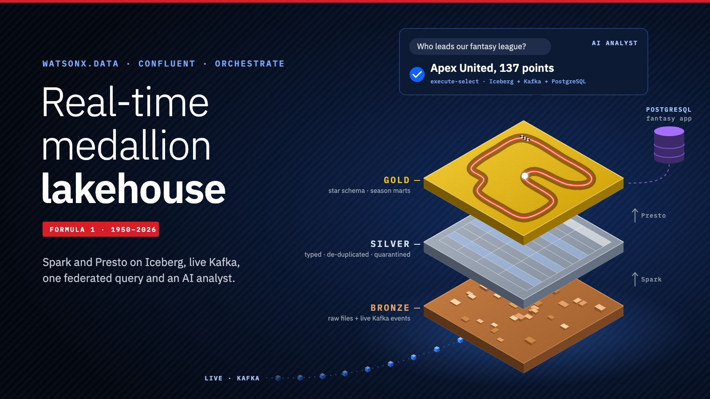

## Introduction

Most data teams end up with three kinds of data that never quite meet. Years of history sit in files or a warehouse. Today's events arrive on a Kafka topic. The application that people actually use keeps its own operational database. Answering a simple question such as *"who is leading right now?"* means copying data between all three, and by the time it has been copied, it is out of date.

In this tutorial, you build a lakehouse that brings the three together without copying them into one place. It uses three products:

- **[IBM watsonx.data](https://www.ibm.com/products/watsonx-data)** holds the history as Apache Iceberg tables in Cloud Object Storage. Apache Spark cleans the data through a bronze, silver and gold *medallion* architecture, and Presto queries it with SQL. Presto also reaches out to the other two systems, so one SQL statement can join all three.
- **[Confluent Cloud](https://www.confluent.io/confluent-cloud/)** carries the live events. Presto can read the topic the moment a message lands, and Spark Structured Streaming lands the same messages in the lakehouse exactly once.
- **[IBM watsonx Orchestrate](https://www.ibm.com/products/watsonx-orchestrate)** runs an AI agent that turns plain-English questions into Presto SQL. It connects through the watsonx.data MCP server, so you write no tool code.

The example is Formula 1: every Grand Prix and sprint result from 1950 to 2025, the 2026 season streamed race by race, and a fictional fantasy-league app whose managers pick drivers each season.

### What you'll learn

- How to build bronze, silver and gold layers on Apache Iceberg, with Spark for the heavy transformations and Presto for SQL modelling.
- How to make a pipeline safe to re-run, with `MERGE INTO`, change detection and a quarantine table for bad rows.
- How to land a Kafka topic in the lakehouse exactly once with Spark Structured Streaming, and how to query the same topic live from Presto.
- How to federate Iceberg, Kafka and PostgreSQL in a single Presto query.
- How to use Iceberg snapshots to see a table as it was before a load.
- How to connect a watsonx Orchestrate agent to the watsonx.data MCP server, and give it a knowledge base that explains what the data means.

### What you'll build

When you finish, you can ask the agent questions like these and get answers computed from live data:

- *Who leads our fantasy league in 2026? Captains score double.*
- *Which constructors finished the most races in 2025, and how many cars retired?*
- *Who leads the 2026 championship after the race that just finished?*

The first question needs all three sources: the fantasy picks live in PostgreSQL, the points live in the lakehouse, and the newest race may still be only on the Kafka topic.

## Architecture


*The F1 lakehouse. Confluent feeds both the streaming load into Bronze and Presto's live queries.*

The solution has five parts:

1. **Landing zone.** The raw files (CSV, JSON lines and JSON arrays) and the Spark application code are uploaded to a landing bucket in Cloud Object Storage.
2. **Medallion layers on Apache Iceberg.** Spark lands the files unchanged in *Bronze*, then cleans, types and de-duplicates them into *Silver*. Presto SQL builds the *Gold* star schema and the season tables that questions are answered from. All three layers are Iceberg tables in one catalog that both engines share.
3. **Confluent Cloud.** A producer publishes each 2026 result to the topic `f1.race.results` as the race ends. The topic is used two ways. Presto reads it in place through a Kafka catalog, so the newest race can be queried within seconds. Spark Structured Streaming lands new messages in Bronze, and the next Silver and Gold runs merge them with the history.
4. **Presto federation.** Presto has three catalogs: the Iceberg lakehouse, `kafka_live` for the topic and `fantasy_pg` for the PostgreSQL app database on Neon. A single SQL statement can join all three, and nothing is copied between them.
5. **The agent.** A watsonx Orchestrate agent running Claude Sonnet 4.6 uses the watsonx.data MCP server as its toolkit. It reads table definitions live, so its instructions contain no schema to go stale. A knowledge base explains what the metrics mean.

### Where your data lives

watsonx.data separates storage from compute. All the lakehouse data is files in Cloud Object Storage; the engines only read and write them.

| Place | What it holds | Who uses it |
|---|---|---|
| Landing bucket (Cloud Object Storage) | The raw CSV and JSON files, the Spark application code and the streaming checkpoint | Spark reads it directly. It is not registered in watsonx.data, because it holds files, not tables. |
| Warehouse bucket (Cloud Object Storage) | Every Bronze, Silver and Gold table, as Apache Iceberg: Parquet data files plus metadata files that record each snapshot | Spark and Presto read and write it |
| Metastore (the Iceberg catalog) | For each table, a pointer to its current metadata file | Spark and Presto look tables up here |
| Confluent Cloud and Neon | The topic and the app database, which stay where they are | Presto reads them at query time |

So when Spark "writes a table", it writes Parquet files to the warehouse bucket and then moves the table's pointer in the metastore to a new snapshot. In watsonx.data, the warehouse bucket is associated with the Iceberg catalog. You can see the association in **Infrastructure manager**: switch to the list view and select **Storage**.

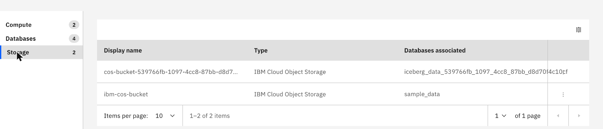

*The warehouse bucket is associated with the Iceberg catalog. The topology view doesn't draw this link, but the list view shows it.*

## Prerequisites

Before you start, make sure you have the following:

- An IBM Cloud account with an [IBM watsonx.data](https://cloud.ibm.com/catalog/services/watsonxdata) instance. The Lite plan works and comes with a Presto (Java) engine, a Spark engine and an Iceberg catalog. You must be an administrator of the instance, because the watsonx.data MCP tools are available only to instance administrators.
- An [IBM watsonx Orchestrate](https://www.ibm.com/products/watsonx-orchestrate) instance. A trial works.
- A [Confluent Cloud](https://confluent.cloud) account. The free trial credit is enough for a Basic cluster.
- A [Neon](https://neon.tech) account for the PostgreSQL database. The free plan is enough.
- Python 3.12, [uv](https://docs.astral.sh/uv/) and Git on your computer.

You don't need to install the watsonx Orchestrate Agent Development Kit (ADK) separately. The project installs version 2.20.0, which this tutorial was tested with.

## Estimated time

It takes about 90 minutes to complete this tutorial. Spark jobs on the Lite plan take two to five minutes each, mostly waiting for capacity.

| Part | What you do | Time |
|---|---|---|
| 1. Set up | Get the code, connect to watsonx.data, create the landing bucket | 15 minutes |
| 2. Build the medallion lakehouse | Bronze and Silver with Spark, Gold with Presto | 20 minutes |
| 3. Add real-time data with Confluent | Stream a race, query it live, land it in Iceberg | 20 minutes |
| 4. Federate with PostgreSQL | Add the fantasy-league database and join all three sources | 10 minutes |
| 5. Add the AI analyst | Connect Orchestrate to the MCP server and deploy the agent | 15 minutes |
| 6. Run a race weekend | Run the whole loop end to end | 10 minutes |

## Part 1. Set up your environment

In this part, you get the code, connect it to your watsonx.data instance and create the landing bucket that raw files arrive in. At the end, the command line can reach both engines.

### Step 1. Get the code and install the tools

In this step, you clone the repository and create a Python environment with everything the tutorial uses.

1. Clone the repository:

    ```bash
    git clone https://github.com/IBM/oic-i-agentic-ai-tutorials.git
    cd oic-i-agentic-ai-tutorials/i-oic-f1-realtime-lakehouse-wxd-confluent
    ```

2. Create the virtual environment and install the dependencies:

    ```bash
    uv venv -p 3.12 .venv
    uv pip install -p .venv -r requirements.txt
    ```

3. Copy the environment template. You fill it in over the next steps:

    ```bash
    cp .env.example .env
    ```

The repository is organised like this:

| Path | What it contains |
|---|---|
| `data/raw/` | Historical results 1950–2025: circuits, races, constructors, drivers, results and sprints |
| `data/stream/` | The 2026 season, replayed to Kafka one race at a time |
| `lakehouse/spark/` | The Bronze, Silver and streaming Spark jobs |
| `lakehouse/sql/` | Gold-layer SQL, live and federated queries, and time-travel queries |
| `lakehouse/cli.py` | The command line that runs every stage: `python -m lakehouse <command>` |
| `streaming/producer.py` | Publishes a 2026 race to Confluent Cloud |
| `postgres/` | The fantasy-league schema, its seed generator and loader |
| `agent/` | The agent definition, knowledge base and deploy script |

### Step 2. Collect your watsonx.data connection details

In this step, you put the details of your watsonx.data instance in `.env`, and check that you can reach both engines.

1. Create an IBM Cloud API key. In IBM Cloud, open **Manage > Access (IAM) > API keys** and click **Create**. Copy the key.
2. Open your watsonx.data instance from the IBM Cloud resource list and click **Launch in watsonx**. Note the region in the console URL, for example `us-south`.
3. Open **Infrastructure manager**. Click the Presto engine and note its **Engine ID** and **Host**. Click the Spark engine and note its **Engine ID**. Click the Iceberg catalog and note its **name** and the **bucket** behind it.
4. Fill in the watsonx.data section of `.env`:

    ```ini
    WXD_HOST=https://us-south.lakehouse.cloud.ibm.com
    WXD_CRN=crn:v1:bluemix:public:lakehouse:us-south:a/<account-id>:<instance-id>::
    WXD_API_KEY=<your IBM Cloud API key>
    WXD_USER=ibmlhapikey_<the email address of the API key's owner>
    PRESTO_ENGINE_ID=presto604
    PRESTO_HOST=<the Presto engine host>
    SPARK_ENGINE_ID=spark293
    ICEBERG_CATALOG=iceberg_data_<instance-id>
    COS_BUCKET=do-not-delete-wxdata-<instance-id>
    COS_ENDPOINT=https://s3.us-south.cloud-object-storage.appdomain.cloud
    ```

    You can copy the CRN from **Configurations > MCP server** in the console, which you use again in Step 12.

5. Check the connection:

    ```bash
    .venv/bin/python -m lakehouse engines
    .venv/bin/python -m lakehouse sql "SHOW CATALOGS"
    ```

    You see both engines and the catalogs Presto can query:

    ```text
    presto  presto604    RUNNING
    spark   spark293     running
    Catalog
    -------------------------------------------------
    iceberg_data_539766fb_1097_4cc8_87bb_d8d70f4c10cf
    jmx
    sample_data
    system
    tpcds
    tpch
    ```

> **Note:** The CLI connects to Presto with the standard [Presto Python client](https://github.com/prestodb/presto-python-client). On watsonx.data SaaS the user name must be `ibmlhapikey_` followed by the email address of the API key's owner. The password is the API key.

### Step 3. Create a landing bucket and HMAC keys

In this step, you create a separate bucket for raw files and Spark application code, and HMAC keys that Spark uses to read and write object storage.

Keeping raw files apart from the lakehouse warehouse is good practice: the landing zone holds data as it was delivered, while the warehouse bucket holds only Iceberg tables.

1. In IBM Cloud, open **Resource list > Storage** and open the Cloud Object Storage instance that contains your watsonx.data bucket.
2. Click **Create bucket**. Create a bucket in the same region as watsonx.data, for example `f1-landing-<something-unique>`.
3. Open **Service credentials** and click **New credential**. Set the role to **Writer** and turn on **Include HMAC Credential**. Click **Add**.
4. Expand the new credential and copy the two values under `cos_hmac_keys` into `.env`:

    ```ini
    LANDING_BUCKET=f1-landing-<something-unique>
    LANDING_HMAC_ACCESS_KEY_ID=<cos_hmac_keys.access_key_id>
    LANDING_HMAC_SECRET_ACCESS_KEY=<cos_hmac_keys.secret_access_key>
    ```

Every Spark job that the CLI submits passes these keys as per-bucket Hadoop settings, in `lakehouse/wxd.py`:

```python
p = f"spark.hadoop.fs.s3a.bucket.{bucket}"
{
    f"{p}.endpoint": self.s.cos_direct_endpoint,
    f"{p}.access.key": self.s.landing_access_key,
    f"{p}.secret.key": self.s.landing_secret_key,
    f"{p}.aws.credentials.provider": "org.apache.hadoop.fs.s3a.SimpleAWSCredentialsProvider",
    f"{p}.custom.signers": "",
    f"{p}.s3.signing-algorithm": "AWSS3V4SignerType",
}
```

> **Important:** The settings are applied to both the landing bucket and the watsonx.data warehouse bucket. On the Lite plan, the watsonx.data request signer that Spark uses by default refused our Spark jobs with *"user not authorized to get signature"*, even for the instance administrator. Because both buckets are in the same Cloud Object Storage instance, one Writer credential covers both.

## Part 2. Build the medallion lakehouse

In this part, you build the three medallion layers. Spark does the heavy lifting for Bronze and Silver, where the data is read from files, cleaned and merged. Presto builds Gold with SQL, where the work is modelling and aggregation. All three layers are Iceberg tables in the same catalog, so each engine reads what the other wrote.

| Layer | Engine | Purpose |
|---|---|---|
| Bronze | Spark | The data exactly as it arrived, plus where it came from |
| Silver | Spark | Typed, cleaned, de-duplicated and merged; bad rows quarantined |
| Gold | Presto | A star schema and season tables that questions are answered from |

### Step 4. Land the raw files

In this step, you upload the historical files and the Spark applications to the landing bucket.

1. Run the upload:

    ```bash
    .venv/bin/python -m lakehouse upload
    ```

    ```text
    Uploading 85 raw files to s3a://f1-landing-539766fb/f1/
    Uploading 3 Spark applications to s3a://f1-landing-539766fb/spark-apps/
    Done: 88 objects uploaded.
    ```

The raw data arrives in four shapes, which is typical of a real landing zone:

| File | Format | Rows |
|---|---|---|
| `circuits.csv`, `races.csv` | CSV with a header | 82 and 1,154 |
| `constructors.json`, `drivers.json` | JSON lines; each driver has a nested `name` object | 214 and 874 |
| `results/results_<year>.json` | 76 files of JSON lines | 25,907 |
| `sprints/sprints_<year>.json` | 5 files, each one JSON array | 500 |

### Step 5. Build the Bronze layer with Spark

In this step, you run a Spark job on the watsonx.data Spark engine that lands every file in an Iceberg table, exactly as it arrived.

Bronze is the record of what was received. Nothing is cleaned or typed here, so a bad value can never fail the load or be silently changed. Open `lakehouse/spark/bronze_ingest.py`:

```python
SOURCES = {
    "circuits":     ("csv",  "circuits.csv",      {"header": "true"}),
    "races":        ("csv",  "races.csv",         {"header": "true"}),
    "constructors": ("json", "constructors.json", {"primitivesAsString": "true"}),
    "drivers":      ("json", "drivers.json",      {"primitivesAsString": "true"}),
    "results":      ("json", "results/*.json",    {"primitivesAsString": "true"}),
    "sprints":      ("json", "sprints/*.json",    {"primitivesAsString": "true", "multiLine": "true"}),
}

for table, (fmt, path, opts) in SOURCES.items():
    df = (spark.read.format(fmt).options(**opts).load(f"{a.landing}/{path}")
          .withColumn("_source_file", F.element_at(F.split(F.input_file_name(), "/"), -1))
          .withColumn("_ingested_at", F.current_timestamp())
          .withColumn("_batch_id", F.lit(batch_id)))
    df.writeTo(f"{ns}.{table}").using("iceberg").tableProperty("format-version", "2").createOrReplace()
```

`primitivesAsString` keeps every JSON value as a string, and every row gets three lineage columns: the file it came from, when it was loaded and the batch.

1. Run the job:

    ```bash
    .venv/bin/python -m lakehouse bronze
    ```

    The CLI uploads the job, submits it to the Spark engine with the REST API, waits for it and prints the job's own log lines:

    ```text
    Submitted bronze_ingest.py as Spark application 0ca42d4e-9021-48f5-8d66-d4a6073110a0
      [   2s] 0ca42d4e-9021-48f5-8d66-d4a6073110a0: accepted
      [  36s] 0ca42d4e-9021-48f5-8d66-d4a6073110a0: running
      [ 174s] 0ca42d4e-9021-48f5-8d66-d4a6073110a0: finished
      | bronze.circuits: 82 rows
      | bronze.races: 1154 rows
      | bronze.constructors: 214 rows
      | bronze.drivers: 874 rows
      | bronze.results: 25907 rows
      | bronze.sprints: 500 rows
    ```

    Every count matches the raw files.

2. Open the Spark engine in **Infrastructure manager** and select the **Applications** tab. You see each job you submit, with its status and timings.

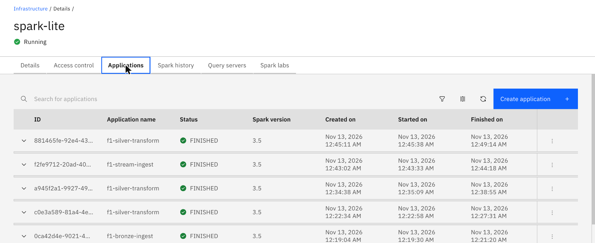

*The pipeline's Spark jobs on the watsonx.data Spark engine.*

> **Tip:** If a job fails, the CLI prints the errors from the Spark driver log. You can also print them later with `python -m lakehouse logs <application-id>`.

### Step 6. Build the Silver layer with Spark

In this step, you run the Spark job that turns Bronze into clean, typed tables, and you see why each data-quality rule is there.

Profiling the raw files turned up real problems, and `lakehouse/spark/silver_transform.py` handles each one:

| Problem in the raw data | What Silver does |
|---|---|
| Strings everywhere | Casts to `INT`, `DOUBLE` and `DATE`, and fixes name casing |
| A nested driver `name` object | Flattens it into `first_name`, `last_name` and `driver_name` |
| Two circuits with a blank ID | Repairs the ID from another row with the same Wikipedia URL |
| 18 results with no season or round | Moves them to `f1_silver.quarantine` with a reason, instead of dropping them |
| 36 duplicate result rows | Keeps one row per **driver and car number**. In the 1950s a driver could share several cars in one race, so keying on the driver alone would delete real results |
| 136 free-text finish statuses | Maps them to a `finish_category` and a `retirement_cause`, so that a lapped finisher is not counted as a retirement |

Every table is written with `MERGE INTO`. Each row carries a hash of its business columns, and rows that already exist unchanged are removed before the merge:

```python
existing = spark.table(target).select(*[F.col(k).alias(f"_t_{k}") for k in keys],
                                      F.col("_row_hash").alias("_t_hash"))
changes = df.join(existing, cond, "left_anti")   # new rows, or rows whose content changed
if changes.count() == 0:
    return {"rows": spark.table(target).count(), "inserted": 0, "updated": 0}
spark.sql(f"""
    MERGE INTO {target} t USING _changes s ON {on}
    WHEN MATCHED THEN UPDATE SET *
    WHEN NOT MATCHED THEN INSERT *
""")
```

The filter matters. Iceberg rewrites every data file that holds a matched row, so merging unchanged rows would rewrite the whole table on every run.

1. Run the job:

    ```bash
    .venv/bin/python -m lakehouse silver
    ```

    ```text
      | silver.circuits: {'rows': 78, 'inserted': 78, 'updated': 0}
      | silver.constructors: {'rows': 214, 'inserted': 214, 'updated': 0}
      | silver.drivers: {'rows': 874, 'inserted': 874, 'updated': 0}
      | silver.races: {'rows': 1149, 'inserted': 1149, 'updated': 0}
      | silver.results: {'rows': 26353, 'inserted': 26353, 'updated': 0}
      | silver.quarantine: {'rows': 18}
    ```

2. Run it again. Nothing has changed in Bronze, so nothing is written and Iceberg records no new snapshot:

    ```text
      | silver.results: {'rows': 26353, 'inserted': 0, 'updated': 0}
    ```

3. Look at the rows that failed the checks:

    ```bash
    .venv/bin/python -m lakehouse sql "SELECT source_table, reason, count(*) AS n FROM \${catalog}.f1_silver.quarantine GROUP BY 1, 2"
    ```

    ```text
    source_table  reason          n
    ------------  --------------  --
    results       missing round   6
    results       missing season  12
    ```

    Each quarantined row keeps the original record as JSON in `raw_record`, so you can fix the source and reload it.

### Step 7. Build the Gold layer with Presto

In this step, you build the business-ready tables with Presto SQL, and check them against results you can verify.

Gold is a star schema: four dimensions (`dim_driver`, `dim_constructor`, `dim_circuit`, `dim_race`), one fact table with a row per driver, car and session (`fact_session_result`), and two season tables that most questions are answered from. This is the driver season table, from `lakehouse/sql/gold/30_marts.sql`:

```sql
CREATE TABLE ${catalog}.${gold}.driver_season AS
WITH s AS (
  SELECT f.season, f.driver_id,
         array_join(array_sort(array_agg(DISTINCT c.constructor_name)), ', ') AS constructors,
         count(DISTINCT CASE WHEN f.session_type = 'RACE' THEN f.round END) AS races,
         sum(f.points) AS points,
         count_if(f.session_type = 'RACE' AND f.is_win) AS wins,
         count_if(f.session_type = 'RACE' AND f.is_podium) AS podiums,
         count_if(f.session_type = 'RACE' AND f.started_on_pole) AS pole_starts
  FROM ${catalog}.${gold}.fact_session_result f
  LEFT JOIN ${catalog}.${gold}.dim_constructor c ON c.constructor_id = f.constructor_id
  GROUP BY 1, 2
)
SELECT s.*, d.driver_name,
       rank() OVER (PARTITION BY s.season ORDER BY s.points DESC, s.wins DESC) AS points_rank
FROM s LEFT JOIN ${catalog}.${gold}.dim_driver d ON d.driver_id = s.driver_id;
```

The fact table is partitioned by season, because almost every question filters on one.

1. Build the Gold layer:

    ```bash
    .venv/bin/python -m lakehouse gold
    ```

    ```text
    table                        rows
    ---------------------------  -----
    f1_gold.constructor_season   1099
    f1_gold.dim_circuit          78
    f1_gold.dim_constructor      214
    f1_gold.dim_driver           874
    f1_gold.dim_race             1149
    f1_gold.driver_season        3106
    f1_gold.fact_session_result  26353
    ```

2. Check the 2025 season against the published final table:

    ```bash
    .venv/bin/python -m lakehouse sql "SELECT points_rank, driver_name, constructors, points, wins FROM \${catalog}.f1_gold.driver_season WHERE season = 2025 ORDER BY points_rank LIMIT 3"
    ```

    ```text
    points_rank  driver_name     constructors  points  wins
    -----------  --------------  ------------  ------  ----
    1            Lando Norris    McLaren       423.0   7
    2            Max Verstappen  Red Bull      421.0   8
    3            Oscar Piastri   McLaren       410.0   7
    ```

3. Now check 1988:

    ```text
    season  points_rank  driver_name   points  wins
    ------  -----------  ------------  ------  ----
    1988    1            Alain Prost   105.0   7
    1988    2            Ayrton Senna  94.0    8
    ```

    Ayrton Senna was the 1988 champion. Before 1991 only a driver's best results counted towards the title, so the total points don't tell the whole story. This is why the column is called `points_rank` and not `championship_position`. In Step 13 you give the agent a knowledge base that explains this, so it doesn't make the mistake in conversation.

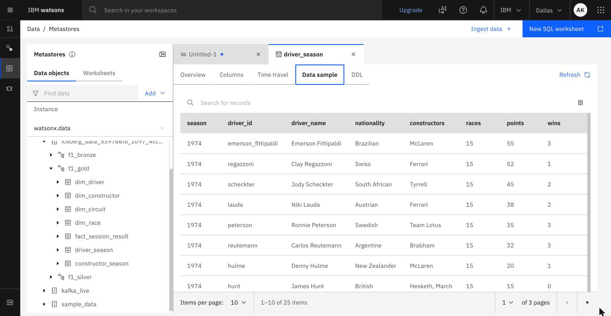

*The Gold layer in the watsonx.data console.*

## Part 3. Add real-time data with Confluent

In this part, the 2026 season starts. Each race result is published to a Confluent Cloud topic as the race ends, and the topic is used in two ways:

1. **Query it live.** Presto reads the topic directly through a Kafka catalog, so the newest race can be queried within seconds, before any pipeline runs.
2. **Land it in the lakehouse.** Spark Structured Streaming copies new messages into Bronze exactly once, and Silver and Gold merge them with the history. There they get joins, snapshots and time travel, and they stay after the topic's retention expires.

### Step 8. Create the Confluent topic and stream a race

In this step, you create the Kafka cluster and publish the first race of the 2026 season.

1. In Confluent Cloud, create a **Basic** cluster on any cloud and region.
2. In the cluster, open **API keys** and create a key for the cluster. Copy the key and the secret.
3. Open **Cluster settings** and copy the **Bootstrap server**.
4. Fill in the Confluent section of `.env`:

    ```ini
    KAFKA_BOOTSTRAP=pkc-xxxxx.<region>.<cloud>.confluent.cloud:9092
    KAFKA_API_KEY=<cluster API key>
    KAFKA_API_SECRET=<cluster API secret>
    KAFKA_TOPIC=f1.race.results
    ```

5. Publish Round 1, the Australian Grand Prix. The producer creates the topic if it doesn't exist, then sends one message per finisher:

    ```bash
    .venv/bin/python -m streaming.producer --round 1
    ```

    ```text
    🏁 2026 Round 1: Australian Grand Prix → topic f1.race.results
      P1  russell          mercedes        25.0 pts  Finished
      P2  antonelli        mercedes        18.0 pts  Finished
      P3  leclerc          ferrari         15.0 pts  Finished
      ...
      P21 piastri          mclaren          0.0 pts  Did Not Start
      P22 hulkenberg       audi             0.0 pts  Did Not Start
    Published 22 results.
    ```

Each message is keyed by season, round and driver, for example `2026-1-russell`. The key means that publishing a race twice is harmless, because Silver merges on the same natural key.

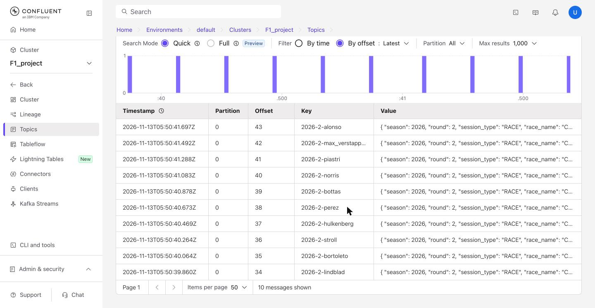

*Race results on the Confluent topic. Each message is one driver's result.*

### Step 9. Query the live topic from Presto

In this step, you register the Confluent cluster as a Presto catalog, and query the race seconds after it finished, before any pipeline has run.

1. Register the cluster and attach it to the Presto engine:

    ```bash
    .venv/bin/python -m lakehouse register kafka
    ```

    ```text
    Registered confluent-f1 as catalog kafka_live (id kafka701)
    Catalog kafka_live attached to presto604; waiting for Presto to load it … ready
    ```

    The command calls the watsonx.data API with this payload. You can do the same in the console under **Infrastructure manager > Add component > Data source > Apache Kafka**:

    ```python
    {
        "display_name": "confluent-f1",
        "type": "kafka",
        "associated_catalog": {"catalog_name": "kafka_live", "catalog_type": "kafka"},
        "connection": {
            "hostname": host, "port": 9092, "hosts": s.kafka_bootstrap,
            "sasl": True, "sasl_mechanism": "plain",
            "username": s.kafka_key, "password": s.kafka_secret,
            "tables": s.kafka_topic,
        },
    }
    ```

    The `tables` field lists the topics to expose. Each one becomes a table in the `default` schema, with the raw message in a `_message` column.

2. Query the topic. `lakehouse/sql/live/kafka_round_results.sql` parses the JSON with Presto's JSON functions:

    ```sql
    SELECT json_extract_scalar(_message, '$.race_name')                  AS race,
           CAST(json_extract_scalar(_message, '$.position') AS INTEGER)   AS pos,
           json_extract_scalar(_message, '$.driver_id')                   AS driver_id,
           json_extract_scalar(_message, '$.constructor_id')              AS team,
           CAST(json_extract_scalar(_message, '$.points') AS DOUBLE)      AS points,
           _partition_offset                                              AS kafka_offset
    FROM kafka_live."default"."f1.race.results"
    ORDER BY kafka_offset
    LIMIT 25
    ```

    ```text
    race                   pos  driver_id       team          points  kafka_offset
    ---------------------  ---  --------------  ------------  ------  ------------
    Australian Grand Prix  1    russell         mercedes      25.0    0
    Australian Grand Prix  2    antonelli       mercedes      18.0    1
    Australian Grand Prix  3    leclerc         ferrari       15.0    2
    ```

3. In the watsonx.data console, open the metastore browser, expand `kafka_live`, and open the **Data sample** tab of `f1.race.results`. The topic looks like any other table.

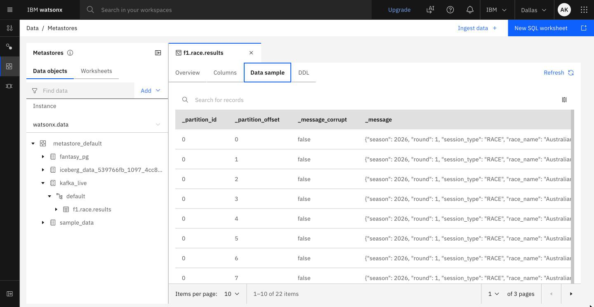

*The Confluent topic as a Presto table. No pipeline has run yet.*

### Step 10. Land the stream in the lakehouse

In this step, you run the streaming job that moves new Kafka messages into Bronze, merge them through Silver and Gold, and use Iceberg time travel to compare the table before and after.

Querying Kafka in place is ideal for the newest data, but a topic is not a history: retention expires messages, and Kafka has no joins, snapshots or schema. So the same messages also land in the lakehouse. `lakehouse/spark/stream_ingest.py` uses Spark Structured Streaming:

```python
q = (stream.writeStream.foreachBatch(write_batch)
     .option("checkpointLocation", a.checkpoint)
     .trigger(availableNow=True)
     .start())
```

`trigger(availableNow=True)` reads every message published since the last run, writes it and stops. The offsets are kept in a checkpoint in the landing bucket, so each message lands exactly once, and no engine waits idle between races.

1. Run the race-weekend refresh. It runs the streaming job, then Silver, then Gold:

    ```bash
    .venv/bin/python -m lakehouse refresh
    ```

    ```text
    ▸ 1/3 Stream: Kafka → Bronze
      | STREAM_SUMMARY new_messages=22 micro_batches=1 total=22
    f1_bronze.race_events now holds 22 Kafka messages
    ▸ 2/3 Silver: MERGE
      | silver.races: {'rows': 1150, 'inserted': 1, 'updated': 0}
      | silver.results: {'rows': 26375, 'inserted': 22, 'updated': 0}
    ▸ 3/3 Gold: rebuild
    Lakehouse refreshed in 627s
    ```

    Silver added the 22 results and one new race, and changed nothing else.

2. List the snapshots of `f1_silver.results`. Every write to an Iceberg table creates one:

    ```bash
    .venv/bin/python -m lakehouse sql lakehouse/sql/time_travel/01_snapshots.sql
    ```

    The last snapshot is the stream's append of 22 rows. In the console, the **Time travel** tab of the table shows the same history, and lets you roll back to any snapshot.

    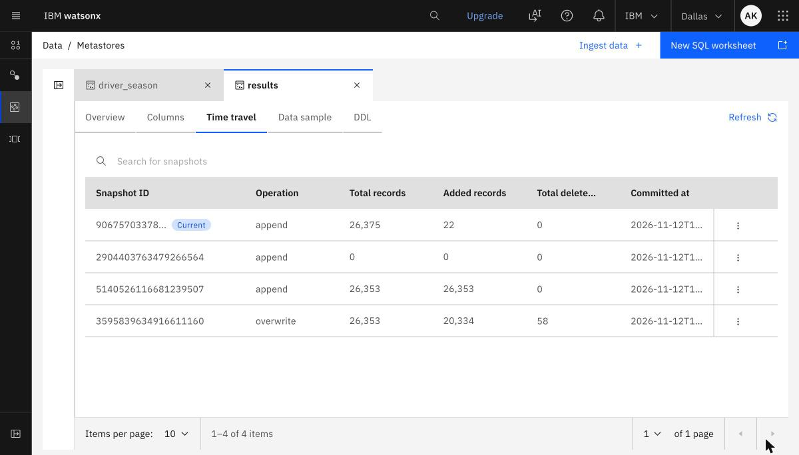

    *The Iceberg snapshot history of the Silver results table.*

    Each snapshot is a set of files in the warehouse bucket. List the files behind the table:

    ```bash
    .venv/bin/python -m lakehouse files f1_silver.results
    ```

    ```text
    s3a://do-not-delete-wxdata-539766fb-1097-4cc8-87bb-d8d70f4c10cf/f1_silver/results/
      data/       136 Parquet files, 2.9 MB
      metadata/    15 files (table metadata, manifests and one snapshot list per commit)
         31494  data/season=2025/00000-4036-4c127636-5761-44ef-832c-3a933fa64109-0-00004.parquet
          7141  data/season=2026/00000-2465-2f21dd28-4f3d-4d0d-aab1-bf7f27525437-0-00001.parquet
          4602  metadata/snap-9067570337874769815-1-8f7d9c6c-e839-463a-ad52-f1d7f64bf20f.avro
    ```

    The table is partitioned by season, so the streamed results sit in their own `season=2026` folder. The `snap-<id>.avro` file is the snapshot you just saw in the Time travel tab.

3. Query the table as it was before the stream. Put the ID of the snapshot before the last one in `lakehouse/sql/time_travel/02_before_after.sql` and run it:

    ```sql
    SELECT 'now' AS version, count(*) AS results_2026
    FROM ${catalog}.f1_silver.results WHERE season = 2026
    UNION ALL
    SELECT 'before stream', count(*)
    FROM ${catalog}.f1_silver.results FOR VERSION AS OF <SNAPSHOT_ID>
    WHERE season = 2026
    ```

    ```text
    version        results_2026
    -------------  ------------
    before stream  0
    now            22
    ```

## Part 4. Federate with PostgreSQL

In this part, you add a third source: the fantasy-league app's own PostgreSQL database. It stays in PostgreSQL. Presto reads it at query time and joins it to the lakehouse and the Kafka topic in one statement.

### Step 11. Federate with PostgreSQL

In this step, you add the fantasy-league app database as a third catalog, and join all three sources in one query.

The fantasy league is a separate application with its own PostgreSQL database: 40 managers, a 2026 price for each driver, and each manager's five picks with one captain who scores double. It stays where it is; Presto reads it at query time.

1. In Neon, create a project. On the project dashboard, click **Connect** and copy the connection string. Put it in `.env`, in quotes, because it contains `&`:

    ```ini
    NEON_PG_URL="postgresql://<user>:<password>@<endpoint>.<region>.aws.neon.tech/neondb?sslmode=require"
    ```

2. Create and fill the tables:

    ```bash
    .venv/bin/python postgres/load.py
    ```

    ```text
    fantasy_managers: 40 rows
    driver_prices: 22 rows
    fantasy_picks: 200 rows
    ```

3. Register the database in watsonx.data and attach it to Presto:

    ```bash
    .venv/bin/python -m lakehouse register postgres
    ```

    Two details in `lakehouse/register.py` make Neon work. It uses Neon's direct endpoint rather than the `-pooler` one, because Presto's JDBC connector keeps sessions that a transaction pooler doesn't preserve. And it uploads the Let's Encrypt root certificate (ISRG Root X1) that signs Neon's certificate: watsonx.data validates a database's TLS certificate against a CA you supply, even for a public CA.

4. Run the fantasy-league table. The picks come from PostgreSQL and the points from Iceberg:

    ```bash
    .venv/bin/python -m lakehouse sql lakehouse/sql/federation/01_fantasy_league_table.sql
    ```

5. Now join all three sources. `lakehouse/sql/federation/02_three_way_live.sql` takes the race that has just finished from the Kafka topic, counts how many managers picked and captained each driver from PostgreSQL, and adds each driver's career wins from the Gold layer:

    ```sql
    WITH live AS (
      SELECT json_extract_scalar(_message, '$.driver_id')                 AS driver_id,
             CAST(json_extract_scalar(_message, '$.round') AS INTEGER)    AS round,
             CAST(json_extract_scalar(_message, '$.position') AS INTEGER) AS position,
             CAST(json_extract_scalar(_message, '$.points') AS DOUBLE)    AS points
      FROM kafka_live."default"."f1.race.results"
    ),
    career AS (
      SELECT driver_id, sum(wins) AS career_wins
      FROM ${catalog}.f1_gold.driver_season GROUP BY driver_id
    )
    SELECT l.position, d.driver_name, l.points AS race_points,
           count(p.manager_id) AS picked_by_managers,
           count_if(p.is_captain) AS captained_by,
           c.career_wins
    FROM live l
    JOIN ${catalog}.f1_gold.dim_driver d ON d.driver_id = l.driver_id
    LEFT JOIN fantasy_pg.public.fantasy_picks p ON p.driver_id = l.driver_id AND p.season = 2026
    LEFT JOIN career c ON c.driver_id = l.driver_id
    WHERE l.round = 1
    GROUP BY 1, 2, 3, 6
    ORDER BY l.position
    LIMIT 10
    ```

    Run it in the watsonx.data SQL worksheet to see the result next to the query:

    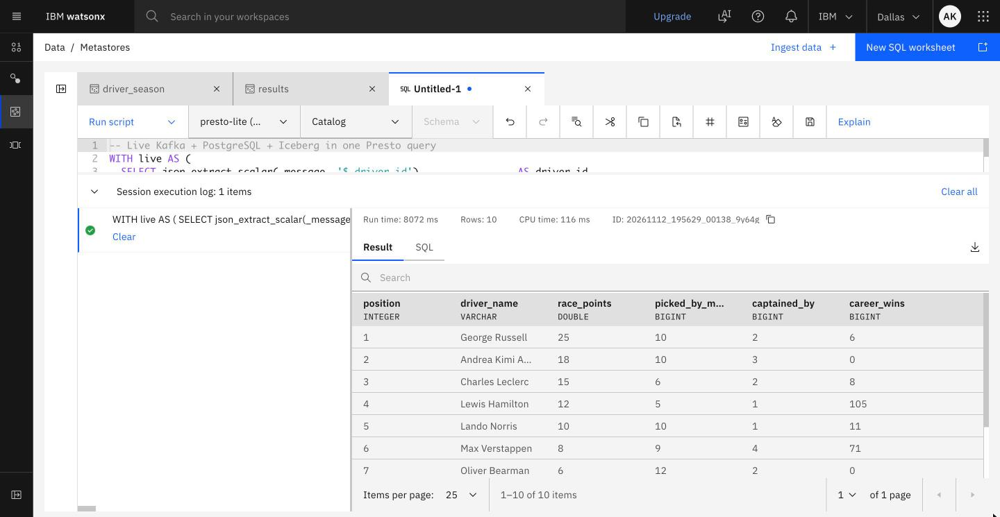

    *One Presto query across Kafka (race points), PostgreSQL (fantasy picks) and Iceberg (career wins).*

6. Open **Infrastructure manager**. The topology now shows both engines, all four catalogs and both buckets:

    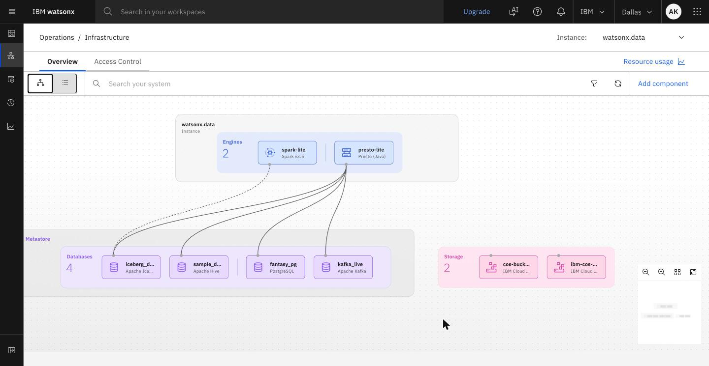

    *The finished lakehouse in Infrastructure manager.*

## Part 5. Add the AI analyst

In this part, you put a watsonx Orchestrate agent on top of everything you built. The agent turns questions into Presto SQL and runs them through the watsonx.data MCP server, so it can reach every catalog Presto can: the lakehouse, the live topic and the app database.

### Step 12. Connect watsonx Orchestrate to the watsonx.data MCP server

In this step, you give watsonx Orchestrate access to watsonx.data through the watsonx.data MCP server, with the credentials stored in a connection.

watsonx.data includes a Model Context Protocol (MCP) server. Its tools list catalogs, schemas and tables, describe a table, and run queries. Because the agent uses these tools directly, you write no tool code, and the agent always sees the current table definitions.

1. In the watsonx.data console, open **Configurations > MCP server**. Note the **MCP URL endpoint** and the **Instance CRN**.

    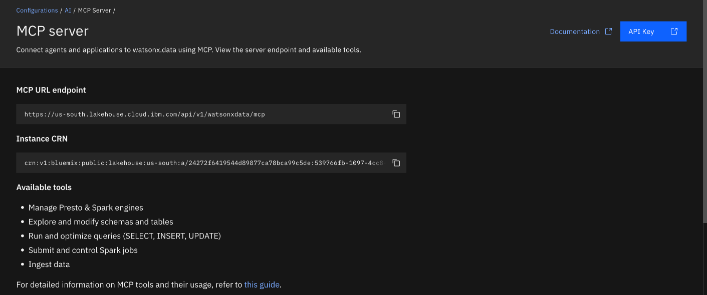

    *The watsonx.data MCP server.*

2. In watsonx Orchestrate, click your avatar, then **Settings > API details**. Copy the **Service instance URL** and generate an API key. Put both in `.env`:

    ```ini
    WXO_INSTANCE_URL=https://api.<region>.watson-orchestrate.cloud.ibm.com/instances/<instance-id>
    WXO_API_KEY=<your watsonx Orchestrate API key>
    ```

`agent/deploy.py` does the rest of this step and the next one. These are the commands it runs for the connection and the toolkit:

```bash
orchestrate connections add -a wxd_mcp
orchestrate connections configure -a wxd_mcp --env draft --type team --kind key_value
orchestrate connections set-credentials -a wxd_mcp --env draft \
    -e "authorization=Basic <base64 of ibmlhapikey_<email>:<api key>>" \
    -e "authinstanceid=<instance CRN>"

orchestrate toolkits add --kind mcp --name watsonx_data \
    --description "IBM watsonx.data: discover schemas and run read-only Presto SQL" \
    --url https://us-south.lakehouse.cloud.ibm.com/api/v1/watsonxdata/mcp \
    --transport streamable_http \
    --tools "watsonxdata-list-schemas,watsonxdata-list-tables,watsonxdata-describe-table,watsonxdata-execute-select" \
    --app-id wxd_mcp
```

Each entry in the key-value connection is sent as an HTTP header on every call to the MCP server: `authorization` authenticates with your API key, and `authinstanceid` selects your watsonx.data instance. The script repeats the configuration for the `live` environment.

The toolkit imports only four tools, all read-only. The MCP server also has tools that create engines, insert rows and submit Spark jobs, and an analyst agent has no need for them.

### Step 13. Deploy the agent and its knowledge base

In this step, you deploy the F1 Race Analyst agent with a knowledge base that explains what the data means.

The agent's instructions, in `agent/f1_race_analyst.yaml.tmpl`, tell it how to work rather than what the tables contain:

```yaml
llm: bedrock/us.anthropic.claude-sonnet-4-6
style: react_core
instructions: |
  You are a Formula 1 data analyst. You answer every question with data from the lakehouse,
  never from memory. If the data cannot answer a question, say so.

  ## How to work
  1. Pick the layer. Answer from the Gold tables in {{CATALOG}}.f1_gold first.
  2. Check columns before you write SQL for a table you have not described in this
     conversation: call watsonxdata-describe-table. Do not guess column names.
  3. Run one SELECT at a time with watsonxdata-execute-select, using engine_id "{{PRESTO_ENGINE}}".
  4. Present the result as a short markdown table followed by two or three sentences of insight.
     Say which tables you used.
tools:
  - watsonx_data:watsonxdata-list-schemas
  - watsonx_data:watsonxdata-list-tables
  - watsonx_data:watsonxdata-describe-table
  - watsonx_data:watsonxdata-execute-select
knowledge_base:
  - f1_lakehouse_guide
```

The knowledge base, `agent/knowledge_base/f1_lakehouse_guide.txt`, is the semantic layer: what a win, a podium or a retirement means, why `points_rank` before 1991 is not the champion, why reliability can't be computed from 2023 onwards, how the fantasy league scores, and worked examples of each kind of query.

1. Deploy everything:

    ```bash
    .venv/bin/python agent/deploy.py
    ```

    The script activates your Orchestrate environment, creates the connection and toolkit from Step 12, imports the knowledge base, renders the agent YAML with your catalog and engine, imports the agent and deploys it.

2. In watsonx Orchestrate, open **Build > Agents > F1 Race Analyst** and select the **Tools** tab. You see the four watsonx.data tools, each of type MCP.

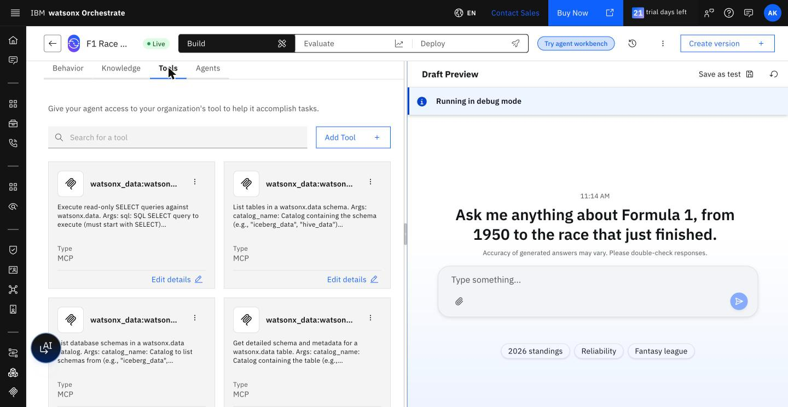

*The agent's tools come straight from the watsonx.data MCP server.*

> **Note:** Imported agents are drafts. They answer in the agent builder's preview and in `orchestrate chat ask`, but they appear in the chat UI only after `orchestrate agents deploy`. The deploy script runs it for you.

### Step 14. Ask the agent

In this step, you ask the agent questions that span the lakehouse and the app database.

1. In watsonx Orchestrate, open **Chat** and select **F1 Race Analyst**. The agent shows its welcome message and three starter prompts.

    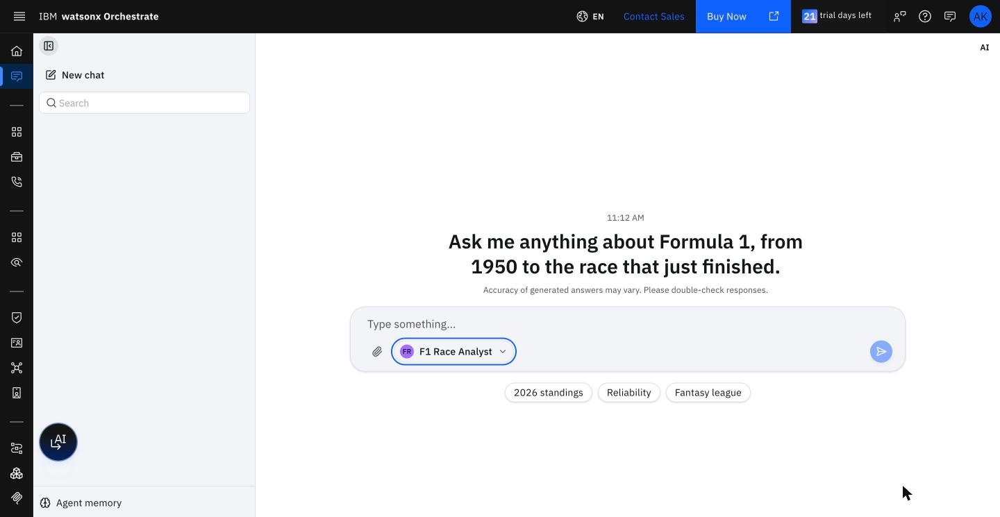

    *The F1 Race Analyst in watsonx Orchestrate chat.*

2. Click **Fantasy league**. The agent answers with the league table, computed from the PostgreSQL picks and the Iceberg points:

    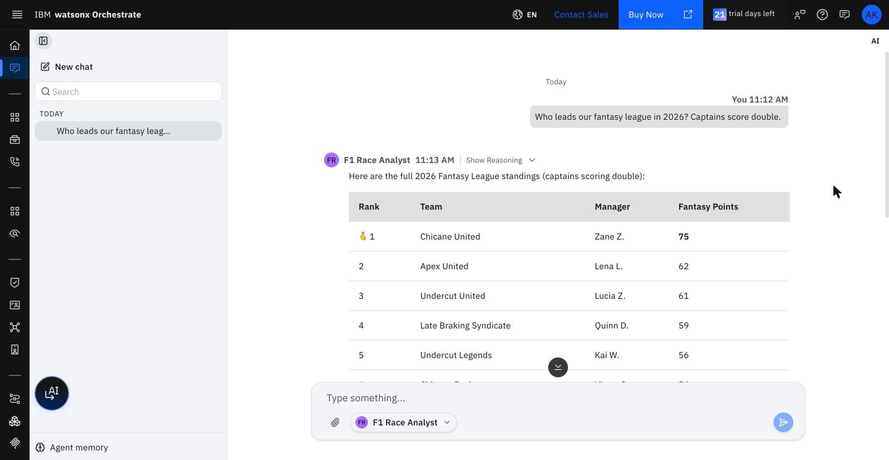

    *The agent's answer to the federated fantasy-league question.*

3. Click **Show Reasoning** and expand the steps. The agent first searched the knowledge base for the scoring rules, then called `watsonxdata-execute-select` with a query it wrote, joining `fantasy_pg` to the Gold layer:

    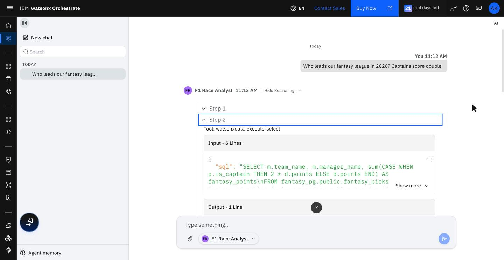

    *The reasoning trace: the agent writes federated SQL and runs it through the MCP server.*

4. Try the other starter prompts, and questions of your own, for example:
    - *Who has the most wins ever at Monaco?*
    - *Who won the 1988 championship?* The knowledge base tells the agent to explain the dropped-scores rule.
    - *What has arrived on the Kafka topic that isn't in the lakehouse yet?*

## Part 6. Run a race weekend

In this part, you run the whole loop the system is built for, with a new race.

### Step 15. Run a race weekend end to end

In this step, a race finishes, the results are queryable at once, the lakehouse catches up, and the agent answers with the new data.

1. Publish Round 2, the Chinese Grand Prix:

    ```bash
    .venv/bin/python -m streaming.producer --round 2
    ```

    In Confluent Cloud, open the topic's **Messages** tab. The chart shows one message per finisher as the race was published. *Consumption in last hour* counts every read by Presto's live queries and by the Spark streaming job.

    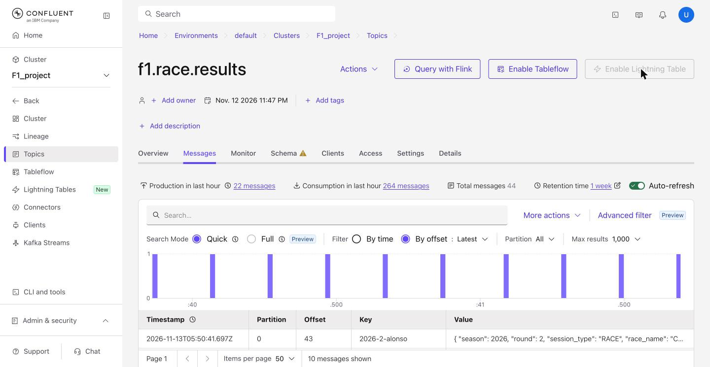

    *Round 2 arriving on the topic. Presto and Spark both consume it.*

2. Ask Presto where each race is now. `lakehouse/sql/live/freshness.sql` compares the topic with the Gold layer:

    ```bash
    .venv/bin/python -m lakehouse sql lakehouse/sql/live/freshness.sql
    ```

    ```text
    round  race                   results_on_topic  results_in_gold  status
    -----  ---------------------  ----------------  ---------------  ----------------
    1      Australian Grand Prix  22                22               in the lakehouse
    2      Chinese Grand Prix     22                0                only on Kafka
    ```

    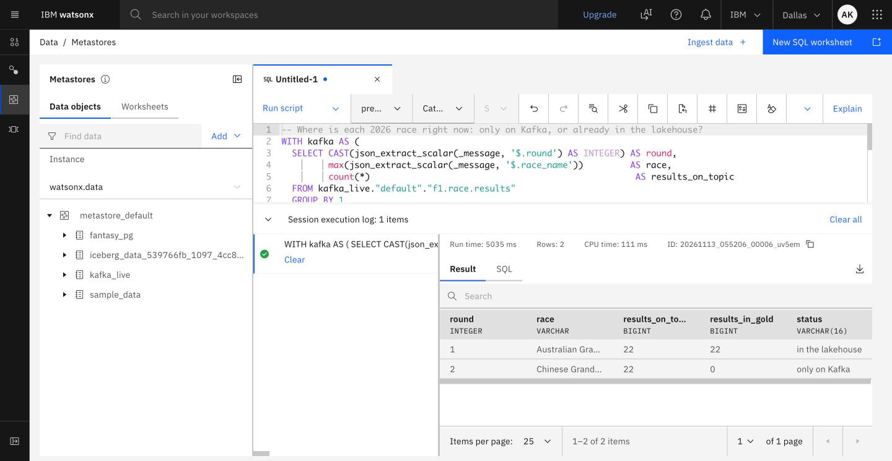

    *Seconds after the race: Round 2 is on Kafka, and the lakehouse hasn't loaded it yet.*

3. You don't have to wait for the pipeline to see the championship. `lakehouse/sql/live/live_standings.sql` adds the points that are still only on Kafka to the Gold-layer standings:

    ```text
    driver_name            lakehouse_points  live_points  total_points
    ---------------------  ----------------  -----------  ------------
    George Russell         25.0              18.0         43.0
    Andrea Kimi Antonelli  18.0              25.0         43.0
    Charles Leclerc        15.0              12.0         27.0
    Lewis Hamilton         12.0              15.0         27.0
    ```

    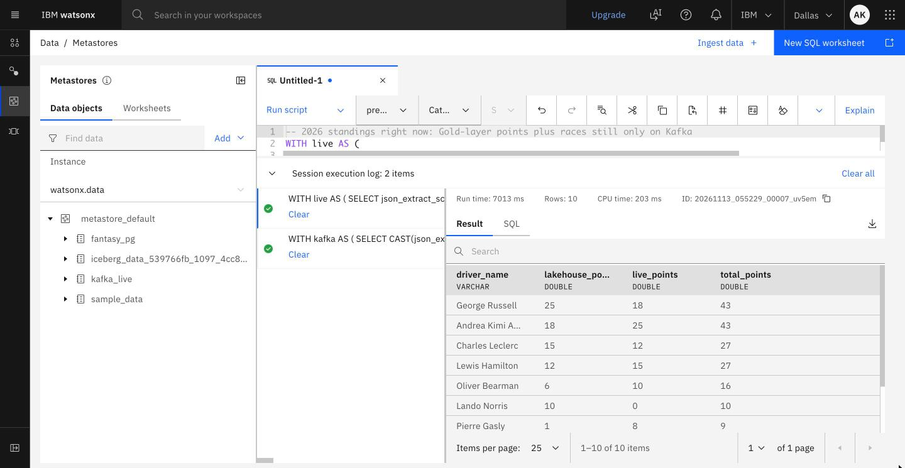

    *Real-time standings: Gold-layer history plus the race still on Kafka, in one query.*

4. Let the lakehouse catch up:

    ```bash
    .venv/bin/python -m lakehouse refresh
    ```

    ```text
    ▸ 1/3 Stream: Kafka → Bronze
      | STREAM_SUMMARY new_messages=22 micro_batches=1 total=44
    ▸ 2/3 Silver: MERGE
      | silver.races: {'rows': 1151, 'inserted': 1, 'updated': 0}
      | silver.results: {'rows': 26397, 'inserted': 22, 'updated': 0}
    ▸ 3/3 Gold: rebuild
    Lakehouse refreshed in 639s
    ```

    The topic now holds 44 messages, but the streaming job read only the 22 that arrived since its last run. The checkpoint remembered where it stopped.

    Run the freshness query again. Both rounds are now in the lakehouse:

    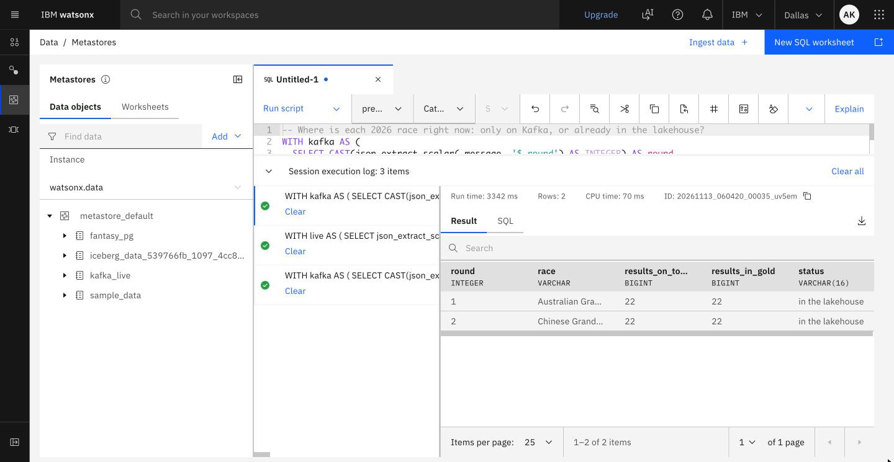

    *After the refresh, the lakehouse has caught up with Kafka.*

5. Ask the agent: *Who leads the 2026 championship after the Chinese Grand Prix?* It answers from the refreshed Gold layer:

    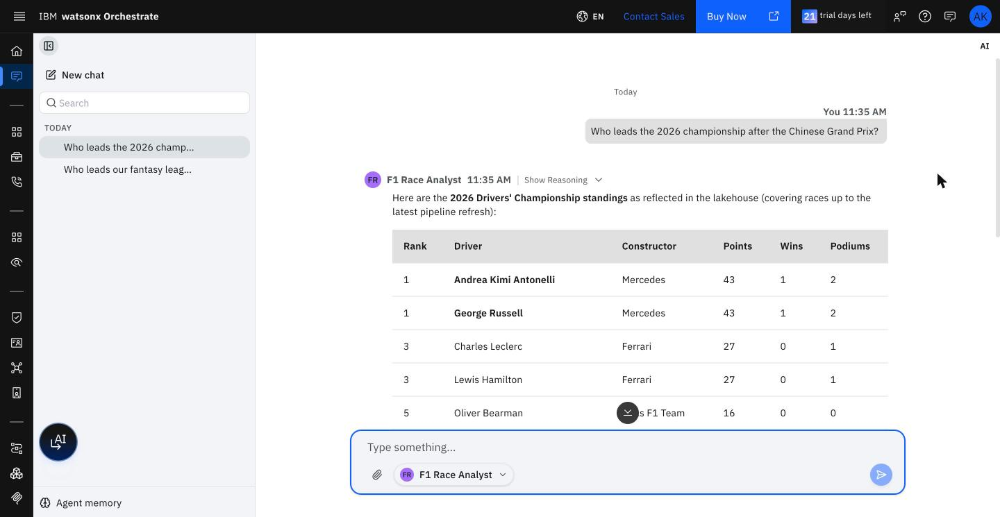

    *The agent answers with the race that finished minutes ago.*

> **Tip:** On the Lite plan, engines use resource units even when idle. Pause Presto when you stop working with `.venv/bin/python -m lakehouse engines pause`, and resume it with `engines resume`. The Lite plan doesn't allow pausing the Spark engine, but Spark uses no compute between jobs.

## Troubleshooting

#### A Spark job fails with "Please provide valid api key" or "user not authorized to get signature"

watsonx.data's request signer couldn't authorize Spark's access to object storage. Check that the landing bucket and HMAC keys in `.env` are set (Step 3). The CLI applies the keys to both buckets.

#### A Spark job fails with "The request signature we calculated does not match"

The S3 signer for the bucket is wrong. Use `AWSS3V4SignerType`, as `lakehouse/wxd.py` does. The generic `AWS4SignerType` signs uploads differently and fails on writes.

#### Presto returns 401 "User format invalid"

Set `WXD_USER` to `ibmlhapikey_` followed by the email address of the API key's owner. A bare `ibmlhapikey` works for some watsonx.data APIs but not for Presto on SaaS.

#### A query on kafka_live fails with "Cannot list splits"

Presto has no broker address for the cluster. Register it with the `hosts` field set to the bootstrap server, as `register.py` does; without it, the catalog's `kafka.nodes` property is empty. Delete the old registration first.

#### A new catalog doesn't appear in Presto

Associating a catalog makes Presto reload its catalogs, which takes one to two minutes. If it never appears, check that the association call sends `{"catalog_names": ["<name>"]}` as an array.

#### Registering Neon fails with "Connection failed - Invalid hostname or credentials"

Use the direct endpoint (without `-pooler`), turn on SSL, upload the ISRG Root X1 certificate and turn on certificate validation. `python -m lakehouse register postgres` does all four.

#### The knowledge base import fails with "Unsupported file type text/markdown"

Orchestrate knowledge bases accept text, PDF, Word, PowerPoint, HTML and CSV files, but not Markdown. Keep the guide as a `.txt` file.

#### The agent doesn't appear in the chat UI

Run `orchestrate agents deploy --name f1_race_analyst`. Imported agents are drafts until they are deployed.

#### `source .env` fails with "parse error near &"

Put the Neon connection string in double quotes in `.env`.

## Lessons from building it

- **Let the engines do the work.** An earlier version of this project read Silver and Gold rows out through Presto into Python, cleaned them locally and loaded CSV files back. Moving the transforms into Spark and Presto made each stage one job, kept the types intact, and removed a page of pagination code.
- **Filter before you MERGE.** Iceberg's copy-on-write `MERGE` rewrites every file that holds a matched row, even when no value changes. Removing unchanged rows first, with a hash and an anti-join, turned a full-table rewrite on every run into no write at all.
- **Find the real natural key.** Results look unique per driver and race, but in the 1950s drivers shared cars, so one driver could finish a race twice. The key is driver and car number.
- **Data meaning changes over time.** From 2023 the source records most retirements only as "Retired". A reliability metric computed blindly showed every team at 100%. The Gold layer now reports a finish rate for every season and leaves reliability empty where the cause is unknown, and the knowledge base tells the agent why.
- **Use Kafka for now and Iceberg for always.** Presto's Kafka catalog answers questions about the newest race with no pipeline at all. The lakehouse gives the same data history, joins, snapshots and time travel. With `availableNow`, the streaming load costs nothing between races.
- **Let the agent discover the schema.** The agent's instructions name no columns. It calls `describe-table` when it needs to, so it can't drift out of date as the tables change. The knowledge base carries what a schema can't: what the numbers mean.
- **Check the result of every import.** The ADK can log an import error and still exit with status 0. `deploy.py` lists the knowledge bases and agents after importing them, and stops if one is missing.

## Summary

You built a lakehouse on IBM watsonx.data that keeps 75 years of Formula 1 results in Apache Iceberg, cleaned by Spark through bronze and silver layers and modelled by Presto into a gold star schema. Confluent Cloud carries the live season: Presto reads the topic in place for the newest race, and Spark Structured Streaming lands it in the lakehouse exactly once. Presto joins the lakehouse, the topic and a PostgreSQL app database in one query, and a watsonx Orchestrate agent answers questions about all of it through the watsonx.data MCP server, with a knowledge base that explains what the data means.

## Next steps

- **Schedule the refresh.** Run `python -m lakehouse refresh` after each race from a scheduler, or wrap it in a watsonx Orchestrate agentic workflow.
- **Try Confluent Tableflow.** Tableflow can materialize a topic as an Iceberg table directly. Compare it with the Structured Streaming load in Step 10.
- **Add access policies.** Use watsonx.data data access policies to mask the fantasy managers' names for some users, and see the agent respect them.
- **Connect a BI tool.** Point a dashboard at the same Presto catalogs, so the dashboard and the agent answer from the same tables.

The complete source is in the [GitHub repository](https://github.com/IBM/oic-i-agentic-ai-tutorials/tree/main/i-oic-f1-realtime-lakehouse-wxd-confluent).

To learn more, see the [watsonx.data documentation](https://www.ibm.com/docs/en/watsonxdata/saas), the [watsonx Orchestrate ADK documentation](https://developer.watson-orchestrate.ibm.com/) and the [Confluent Cloud documentation](https://docs.confluent.io/cloud/current/overview.html).
