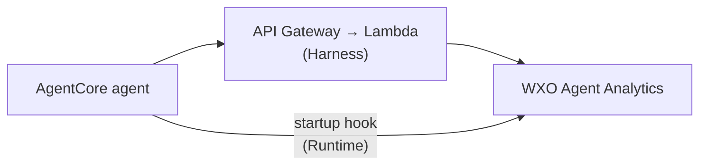
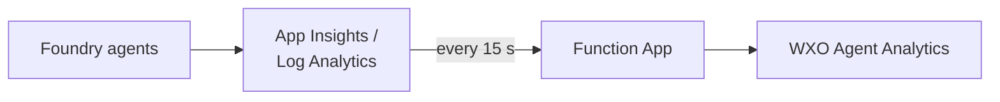
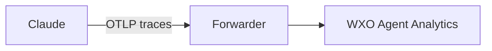

# WXO Agent Analytics Tracing

Sends traces from agents running on **AWS**, **Azure**, **Google Cloud (Vertex AI)** and **Claude** to **IBM watsonx Orchestrate (WXO) Agent Analytics** using OpenTelemetry.

Each platform has one command and one config file under `config/`.

---

## Supported platforms

| Platform | Command | How it works |
|---|---|---|
| **AWS AgentCore — Harness** | `./wire_agent.sh --aws --harness` | Injects `OTEL_*` env vars into the AWS-managed Harness. Spans go API Gateway → Lambda → WXO. No image change. |
| **AWS AgentCore — Runtime** | `./wire_agent.sh --aws --runtime` | Patches your ECR image with a small startup hook that posts spans to WXO. |
| **Azure AI Foundry** | `./azure.sh` | An Azure Function App polls Log Analytics every 15 s and forwards spans to WXO. One deployment covers all agents. |
| **Vertex AI — Reasoning Engine** | `./wire_agent.sh --vertex --reasoning-engine` | Embeds WXO tracing in the Reasoning Engine's `query()`. |
| **Vertex AI — Self-hosted** | `./wire_agent.sh --vertex --selfhosted` | Patches your Cloud Run / GKE image with the same startup hook. |
| **Claude** | `./claude.sh` | Deploys a small trace forwarder and points Claude's OpenTelemetry export at it. See [Claude](#claude). |

---

## Repository structure

```
wxo-external-agent-tracing/
├── wire_agent.sh        ← AWS / Vertex entrypoint (also loads config for the scripts below)
├── azure.sh             ← Azure entrypoint
├── claude.sh            ← Claude entrypoint
├── config.env.example   ← Optional single-file config (all platforms)
├── config/              ← Per-platform config examples (shared, aws, azure, vertex, claude)
└── src/                 ← All code (no need to edit)
    ├── aws/  azure/  vertex/   ← Platform deployers
    ├── forwarder/              ← Claude trace forwarder (AWS Lambda, Azure Function, Docker)
    └── shared/sitecustomize.py ← Startup hook used by the AWS Runtime and Vertex self-hosted flows
```

---

## Quick start

### Step 1 — Configure

Use the example files as templates and fill in the values for the platform(s) you use. Pick **one** of the two options.

**Option A — one file per platform (in `config/`)**

```bash
cp config/shared.env.example config/shared.env   # WXO API key, used by every platform
cp config/aws.env.example    config/aws.env      # copy only the platforms you use:
cp config/azure.env.example  config/azure.env    #   aws, azure, vertex, claude
cp config/vertex.env.example config/vertex.env
cp config/claude.env.example config/claude.env
```

Edit each copied file; the comments in it explain every value.

**Option B — one file for everything**

```bash
cp config.env.example config.env
```

`config.env` has a section per platform (`[aws]`, `[azure]`, `[vertex]`, `[claude]`). Fill in only the sections you use.

Check what is configured at any time:

```bash
./wire_agent.sh --status          # readiness table for all platforms
./wire_agent.sh --show aws        # settings for one platform
```

### Step 2 — Run

```bash
# AWS
./src/aws/ssm_params.sh                       # once: store WXO credentials in SSM
./wire_agent.sh --aws --harness               # or --runtime

# Azure
az login
./azure.sh                                    # add --publish-only to redeploy code only

# Vertex
gcloud auth login
./wire_agent.sh --vertex --reasoning-engine   # or --selfhosted

# Claude
./claude.sh
```

Add `--dry-run` to any command to preview without changing anything. If a script is not executable, run `chmod +x wire_agent.sh azure.sh claude.sh src/*/*.sh`.

---

## Platform details

### AWS AgentCore

- **Harness** (`--harness`): no image change. `wire_agent.sh` sets `OTEL_*` env vars on the Harness and stores the agent identity in SSM.
- **Runtime** (`--runtime`): `wire_agent.sh` builds a patched ECR image and updates the Runtime.



**Prerequisites:** AWS CLI authenticated; Docker running (Runtime only); `ssm_params.sh` run once.

### Azure AI Foundry

Deploys one Azure Function App that polls Application Insights / Log Analytics and forwards spans to WXO. It covers all prompt and hosted agents in the workspace.



**Prerequisites:** `az` CLI logged in and `func` CLI installed (`brew install azure-functions-core-tools@4`), Contributor on the resource group plus Owner or User Access Administrator on the Log Analytics workspace (needed to grant the Function App Monitoring Reader), an existing Application Insights / Log Analytics workspace that receives your Foundry telemetry, and globally unique storage account and Function App names; if deployment fails, check these first, then `Microsoft.Web` / `Microsoft.Storage` provider registration and Consumption plan availability in your region.

### Vertex AI

- **Reasoning Engine** (`--reasoning-engine`): re-uploads the agent with WXO tracing embedded. The existing engine is updated, not recreated.
- **Self-hosted** (`--selfhosted`): builds a patched image and deploys it to Cloud Run (or just pushes it for GKE).

**Prerequisites:** `gcloud` authenticated, Docker running.

### Startup hook (`sitecustomize.py`)

The AWS Runtime and Vertex self-hosted flows add `src/shared/sitecustomize.py` to your container image. Python loads it at startup and it sends traces to WXO, so your agent code does not change.

---

## Claude

`./claude.sh` deploys a small forwarder (AWS Lambda, Azure Function or Docker) and points Claude's OpenTelemetry export at it. The forwarder sends Claude's traces to your WXO agent.



**1. Configure:** fill in `config/claude.env` (or the `[claude]` section of `config.env`) using `config/claude.env.example` as the guide and run **./claude.sh**.


This deploys the forwarder and prints its URL. If `ANTHROPIC_ADMIN_API_KEY` is set in your shell/env, the script also sets that URL as the Claude telemetry destination for you. If it is not set, set the printed URL as the OpenTelemetry destination in Claude yourself.


**Useful commands:** `./claude.sh --sync` pushes an edited `WXO_AGENT_MAP` without redeploying; `--metadata-only` leaves prompts and responses out of the traces; `--unregister-anthropic` removes the Claude destination.

---

## Troubleshooting

| Symptom | Likely cause | Fix |
|---|---|---|
| No traces in WXO | Missing credentials or URL | Check `API_KEY` and `WXO_OTEL_EXPORT_URL`; run `./wire_agent.sh --status` |
| `WXO_OTEL_EXPORT_URL not set` | Config file not found | Confirm `config/shared.env` and the platform file (or `config.env`) exist |
| Claude: traces not mapped to an agent | Name mismatch | The service name Claude sends must match a `WXO_AGENT_MAP` key (or add a `"default"` entry) |
| AWS: no trace after Harness update | Collector not receiving | `aws logs tail /aws/lambda/wxo-agentcore-trace-hook --follow` |
| AWS: Runtime image not patched | Docker not running | Start Docker, re-run `--runtime` |
| Azure: Function App not publishing | `func` CLI missing | `brew install azure-functions-core-tools@4` |
| Vertex: Reasoning Engine not updating | SDK missing | `pip install "google-cloud-aiplatform[agent_engines]>=1.60.0" cloudpickle` |
| Vertex: self-hosted — no hook logs | Image not pushed | Re-run `--selfhosted` |

---

## Security

- **Never commit real credentials.** `config/shared.env` and the per-platform `config/*.env` files are in `.gitignore`.
- AWS: credentials are stored in SSM Parameter Store (SecureString).
- Azure: credentials are stored as Function App Settings.
- Vertex: credentials are injected as Cloud Run / Reasoning Engine env vars — use GCP Secret Manager for production.
